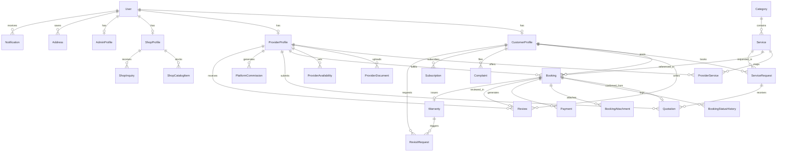

# 🗄️ SevaSetu Relational Database Schema Documentation

**Database Engine:** PostgreSQL 16+ / 18  
**ORM:** Prisma 5.x / 6.x  
**Schema Path:** `Backend/prisma/schema.prisma`  
**Total Relational Entities:** 36+ Core Models

---

## 1. Entity Relationship Overview

---

## 2. Core Relational Models

### 2.1 User & Identity Hierarchy

#### `User`
Primary authentication and account identity record.
- `id` (String, UUID, Primary Key)
- `email` (String, Unique, Indexed)
- `phone` (String, Optional)
- `passwordHash` (String) – Encrypted with bcrypt (10 rounds)
- `role` (Role Enum: `CUSTOMER`, `PROVIDER`, `SHOP_OWNER`, `ADMIN`)
- `isActive` (Boolean, Default: `true`)
- `isVerified` (Boolean, Default: `false`)
- `createdAt`, `updatedAt` (DateTime)

#### `CustomerProfile`
Profile metadata for residential and enterprise clients.
- `id` (String, UUID, PK)
- `userId` (String, FK -> `User.id`, Unique)
- `fullName` (String)
- `avatarUrl` (String, Optional)
- `bio` (String, Optional)
- `emergencyContact` (String, Optional)

#### `ProviderProfile`
Professional credentials, trade category, location, and rating metrics.
- `id` (String, UUID, PK)
- `userId` (String, FK -> `User.id`, Unique)
- `businessName` (String, Optional)
- `fullName` (String)
- `avatarUrl` (String, Optional)
- `bio` (String, Optional)
- `experienceYears` (Int, Default: `0`)
- `skills` (String Array)
- `verificationStatus` (Enum: `PENDING`, `APPROVED`, `REJECTED`, `SUSPENDED`)
- `rejectionReason` (String, Optional)
- `isAvailable` (Boolean, Default: `true`)
- `ratingAverage` (Float, Default: `0.0`)
- `ratingCount` (Int, Default: `0`)
- `primaryCategory` (String, Optional)
- `latitude`, `longitude` (Float, Optional)
- `servicePincode` (String, Optional, Indexed)
- `serviceRadiusKm` (Float, Default: `15.0`)

#### `ShopProfile`
Local hardware, sanitary, electrical, and spare parts store registry.
- `id` (String, UUID, PK)
- `userId` (String, FK -> `User.id`, Unique)
- `shopName` (String)
- `ownerName` (String)
- `shopCategory` (String)
- `description` (String, Optional)
- `bannerUrl` (String, Optional)
- `address`, `city`, `pincode` (String, Indexed)
- `latitude`, `longitude` (Float, Optional)
- `contactPhone`, `contactEmail` (String)
- `openingHours` (String, Optional)
- `verificationStatus` (Enum: `PENDING`, `APPROVED`, `REJECTED`)
- `isActive` (Boolean, Default: `true`)

---

## 3. Catalog & Hyperlocal Taxonomy

#### `Category`
Standardized platform service classifications.
- `id` (String, UUID, PK)
- `name` (String, e.g. "Electrician", "Plumber", "AC Repair")
- `slug` (String, Unique)
- `description` (String, Optional)
- `iconUrl`, `imageUrl` (String, Optional)
- `displayOrder` (Int, Default: `0`)
- `isActive` (Boolean, Default: `true`)

#### `Service`
Granular service offerings within categories.
- `id` (String, UUID, PK)
- `categoryId` (String, FK -> `Category.id`)
- `name` (String, e.g. "Ceiling Fan Repair")
- `slug` (String, Unique)
- `description` (String, Optional)
- `basePrice` (Float, Default: `0.0`)
- `priceType` (Enum: `FIXED`, `HOURLY`, `INSPECTION`)
- `estimatedDurationMinutes` (Int, Default: `60`)
- `warrantyDays` (Int, Default: `30`)
- `imageUrl` (String, Optional)
- `isActive` (Boolean, Default: `true`)

---

## 4. Bookings & State Transitions

#### `Booking`
Master service appointment and work order record.
- `id` (String, UUID, PK)
- `bookingNumber` (String, Unique, e.g. "BK-123456-789")
- `customerId` (String, FK -> `CustomerProfile.id`)
- `providerId` (String, FK -> `ProviderProfile.id`, Optional)
- `serviceId` (String, FK -> `Service.id`)
- `bookingType` (Enum: `NORMAL`, `EMERGENCY`)
- `status` (Enum: `PENDING`, `ACCEPTED`, `IN_PROGRESS`, `COMPLETED`, `CANCELLED`, `REJECTED`)
- `cancellationReason` (String, Optional)
- `problemDescription` (String)
- `bookingDate` (DateTime)
- `timeSlot` (String, Optional)
- `serviceAddress`, `addressPincode` (String)
- `latitude`, `longitude` (Float, Optional)
- `totalAmount` (Float)
- `paymentStatus` (Enum: `PENDING`, `PAID`, `REFUNDED`)
- `paymentMethod` (Enum: `CASH`, `ONLINE`, `UPI`)
- `completedAt`, `cancelledAt` (DateTime, Optional)

#### `BookingStatusHistory`
Immutable audit log tracking every lifecycle change.
- `id` (String, UUID, PK)
- `bookingId` (String, FK -> `Booking.id`)
- `status` (BookingStatus Enum)
- `comment` (String, Optional)
- `changedByUserId` (String)
- `createdAt` (DateTime)

---

## 5. Multiple Quotation Bidding Engine

#### `ServiceRequest`
Customer broadcast asking eligible technicians for price quotations.
- `id` (String, UUID, PK)
- `requestNumber` (String, Unique, e.g. "REQ-123456-789")
- `customerId` (String, FK -> `CustomerProfile.id`)
- `serviceId` (String, FK -> `Service.id`)
- `title` (String)
- `description` (String)
- `address`, `pincode` (String)
- `preferredDate` (DateTime)
- `preferredTimeSlot` (String, Optional)
- `budgetEstimate` (Float, Optional)
- `status` (Enum: `OPEN`, `QUOTED`, `CONFIRMED`, `EXPIRED`, `CLOSED`)

#### `Quotation`
Independent, non-negotiable price proposal submitted by an approved technician.
- `id` (String, UUID, PK)
- `serviceRequestId` (String, FK -> `ServiceRequest.id`)
- `providerId` (String, FK -> `ProviderProfile.id`)
- `quotedAmount` (Float) – Total proposed service charge
- `estimatedDuration` (String)
- `notes` (String, Optional)
- `validUntil` (DateTime, Optional)
- `status` (Enum: `PENDING`, `SELECTED`, `NOT_SELECTED`, `EXPIRED`)
- `createdAt`, `updatedAt` (DateTime)
- `@@unique([serviceRequestId, providerId])` – One quote per provider per request

---

## 6. Financial Ledger & Platform Commission

#### `Payment`
Transaction log for online, UPI, and cash disbursements.
- `id` (String, UUID, PK)
- `bookingId` (String, FK -> `Booking.id`, Unique)
- `transactionId` (String, Optional)
- `amount` (Float)
- `currency` (String, Default: `"INR"`)
- `status` (PaymentStatus Enum: `PENDING`, `SUCCESSFUL`, `FAILED`, `REFUNDED`)
- `paymentMethod` (String)
- `createdAt` (DateTime)

#### `PlatformCommission`
Automatic revenue accounting split (10% Platform, 90% Provider).
- `id` (String, UUID, PK)
- `paymentId` (String, FK -> `Payment.id`, Unique)
- `providerId` (String, FK -> `ProviderProfile.id`)
- `grossAmount` (Float)
- `commissionRate` (Float, Default: `0.10` / 10%)
- `commissionAmount` (Float)
- `providerEarning` (Float)
- `createdAt` (DateTime)

---

## 7. Warranty & Revisit System

#### `Warranty`
30-Day service guarantee automatically created upon job completion.
- `id` (String, UUID, PK)
- `certificateNumber` (String, Unique, e.g. "WAR-2026-XXXX")
- `bookingId` (String, FK -> `Booking.id`, Unique)
- `validFrom` (DateTime)
- `validUntil` (DateTime) – Automatically computed as `validFrom + 30 days`
- `status` (Enum: `ACTIVE`, `EXPIRED`, `CLAIMED`)

#### `RevisitRequest`
Customer request for complimentary warranty inspection.
- `id` (String, UUID, PK)
- `warrantyId` (String, FK -> `Warranty.id`)
- `customerId` (String, FK -> `CustomerProfile.id`)
- `reason` (String)
- `preferredDate` (DateTime)
- `status` (Enum: `PENDING`, `SCHEDULED`, `COMPLETED`, `REJECTED`)
- `createdAt`, `updatedAt` (DateTime)
